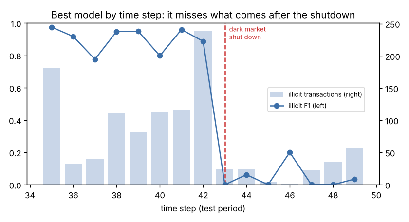

# Anti-Money-Laundering Detection on a Real Bitcoin Transaction Graph

This project flags illicit Bitcoin transactions, with and without the payment graph around each one, and tests whether the detector keeps working when criminal behaviour changes. It uses the Elliptic dataset of real transactions labelled by Elliptic, a blockchain analytics company.

## Data

**Elliptic Bitcoin dataset** (Weber et al., "Anti-Money Laundering in Bitcoin", KDD 2019 workshop):

- 203,769 real Bitcoin transactions and 234,355 payment flows between them, over 49 time steps (about two weeks each).
- 4,545 transactions are labelled illicit (scams, ransomware, dark markets and similar), 42,019 licit, and 77% are unknown.
- Each transaction has 93 features of its own and 72 the authors computed from its neighbours. The features are anonymised, so they can't be named.

I use the copy hosted by PyTorch Geometric. My build machine can't reach that host, so `tools/fetch_urls.py` mirrors it in GitHub Actions into this repo's `data-v2` release, and `data.py` checks the SHA-256.

**Split:** I train on time steps 1 to 34 and test on 35 to 49, the split the dataset's authors use. The model is always scored on transactions later than the ones it learned from, as it would be in production.

## Models

| Model | Features |
|---|---|
| logistic regression | the transaction's own 93 features |
| XGBoost, local | the same 93 features |
| XGBoost, all | plus the authors' 72 neighbour features |
| XGBoost, all + graph | plus my graph features: in and out degree, the average features of the transactions that paid in and of those it paid out to, and a two-hop average |
| GCN | a 2-layer graph convolutional network on the 93 own features, written in plain PyTorch |

## Results (16,670 labelled test transactions, 6.5% illicit)

From `results/metrics.json`. Scores are for the illicit class at a 0.5 threshold.

| Model | Precision | Recall | F1 | Avg. precision | Precision in top 100 |
|---|---|---|---|---|---|
| logistic regression, local | 0.489 | 0.694 | 0.574 | 0.328 | 0.02 |
| GCN, local | 0.373 | 0.677 | 0.481 | 0.564 | 0.96 |
| XGBoost, local | 0.858 | 0.710 | 0.777 | 0.791 | 1.00 |
| XGBoost, all | 0.931 | 0.728 | 0.817 | 0.804 | 1.00 |
| **XGBoost, all + graph** | **0.959** | 0.726 | **0.826** | **0.809** | **1.00** |

- **The graph helps through features more than through a graph neural network.** Neighbour features raise XGBoost from F1 0.777 to 0.826, mostly by cutting false alarms: precision goes from 0.86 to 0.96. My graph features carry 17.6% of the final model's total gain.
- **The GCN is the weakest graph model here.** It scores F1 0.481, below plain XGBoost on the same features. The dataset's authors found the same: their GCN scored 0.628 F1 against 0.788 for a random forest. Tree models handle these skewed, anonymised features better.
- **The top of the alert queue is clean.** All 100 highest-scored test transactions are illicit for every XGBoost model. For an investigations team that works the queue from the top, this matters more than F1.

## The model fails when criminals change behaviour



| Best model (XGBoost, all + graph) | Precision | Recall | F1 |
|---|---|---|---|
| time steps 35 to 42 | 0.982 | 0.857 | 0.915 |
| time steps 43 to 49 | 0.130 | 0.018 | 0.031 |

A large dark market was shut down around time step 43, as the dataset's authors note. After that, the illicit transactions look different, and the model finds almost none of them: recall falls from 86% to 2%. None of the models I tried recovers. This is the most important result here. A money-laundering model trained on past cases will miss new patterns. It needs drift monitoring (see the [model risk validation toolkit](../model-risk-checker)), regular retraining on new cases, and rules or investigator leads alongside it.

## Limits

- The features are anonymised, so I can't explain an alert in business terms ("many small inputs from new wallets"). A real system would need named features for investigators and regulators.
- 77% of transactions are unlabelled. The scores only cover labelled ones.
- Bitcoin flows are not bank transfers. The approach carries over to transaction graphs at banks, but the numbers do not.

## Running it

```bash
pip install xgboost torch scikit-learn scipy pandas pyarrow matplotlib requests
python run.py            # about 3 minutes on CPU
pytest -q test_aml.py
```
