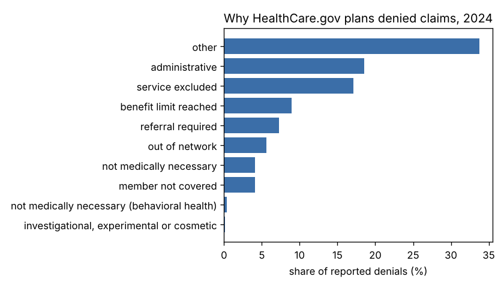

# Claim Denial Analytics and Grounded Appeal Letters

Two parts, both on real public data:
1. **Analytics:** where claim denials come from on HealthCare.gov plans, how rarely people appeal, and whether a plan's denial rate can be predicted.
2. **Appeal drafter:** a free local model writes appeal letters for "not medically necessary" denials. I compare a letter built only from quoted evidence with one written from the whole chart.

## Data

- **CMS Transparency in Coverage public use file, plan year 2024.** Every issuer on HealthCare.gov reports, per plan, the claims received and denied and the denials by reason. Per issuer, it reports the appeals filed and overturned. I mirrored the file into this repo's `data-v2` release because CMS's host isn't reachable from my build machine (SHA-256 pinned in `data.py`).
- For the letters: the 39 real MTSamples notes, the Medicare coverage policies (LCDs) and the quoted checklists from my [prior authorization project](../prior-auth-assistant).

## Part 1: denial analytics (`results/denials.json`)

- **Scale:** 5,050 medical plans from 209 issuers in 32 states, covering 386 million claims, with 68.6 million denied.
- **Denial rates:** 16.1% of in-network claims are denied, and 40.5% of out-of-network ones. Among plans with 1,000+ claims, the in-network denial rate runs from 10.7% (10th percentile) to 23.5% (90th), with a median of 14.6%.
- **Reasons:** most denials are "other" (34%) or administrative (19%). "Not medically necessary" is only 4.1%.



- **Almost nobody appeals, and appeals often win.**
  - Only **1.6 internal appeals are filed per 1,000 denials** (110,084 appeals).
  - **43% of them are overturned.**
  - Among the 110 issuers with 100+ appeals, the overturn rate ranges from 24% to 65% (10th to 90th percentile).
  - This gap is why an appeal drafter is worth building: most denials are never challenged, and almost half of the challenged ones are reversed.
- **The insurer is the story.** 60.3% of the variance in plan denial rates is between issuers. Plans of the same insurer deny at similar rates whatever the state, metal level or plan type.
- **A denial-rate model doesn't generalise to a new insurer.**
  - A gradient-boosted model on state, plan type, metal level and new/returning plan was scored on issuers it never saw (GroupKFold). It gets R² **-0.105**, worse than predicting the average (MAE 5.0 vs 4.6 points).
  - Allowed to see other plans from the same issuer (plain KFold), it gets R² 0.382.
  - Random splits would have reported the 0.38 and hidden that the model only memorises insurers.

## Part 2: appeal letters (`results/appeals.jsonl`, `results/appeals_summary.json`)

For each of the 39 requests, Qwen2.5 3B writes a letter appealing a "not medically necessary" denial in two ways:
- **grounded:** the model sees the denial, the policy and, for up to six policy criteria, the note sentence that best matches each one (BM25), copied word for word. It never sees the rest of the note.
- **free:** the model sees the denial, the criteria and the whole note.

I don't use the 3B checklist's met/not-met verdicts here, because the prior-auth project showed they are unreliable.

Each letter is scored without a reference letter: is every quoted passage really in the note or policy, does it use numbers found in neither, and how much of the given evidence does it use.

| | Grounded | Free |
|---|---|---|
| letters | 39 | 39 |
| quoted passages | 123 | 65 |
| quotes found word for word in the note or policy | **97.6%** | 75.4% |
| letters with a quote that isn't in the sources | 2 | 4 |
| letters with a number in neither the note nor the policy | 2 | 5 |
| share of the given evidence sentences the letter cites | **71%** | 10% |
| median length | 285 words | 322 words |

What I learned:
- **Giving the model only quoted evidence makes letters traceable.** Grounded letters quote twice as much and nearly every quote is real. Free letters often put paraphrased policy text or invented findings in quotation marks. In an appeal, that reads as a false claim about the medical record.
- **Quotes being real doesn't make the argument right.** Reading the letters, the model often claims a sentence supports a criterion when it doesn't. For example, a dose sentence is cited as meeting a rule about botulinum toxin serotypes. The evidence picker (BM25) finds related sentences, not proof. A clinician still has to approve each letter; the tool saves the typing and the citation work.
- Some "unsupported numbers" are false alarms from my checker, such as ICD-9 codes written as "343.0." with a trailing period.

## Limits

- The transparency file is self-reported by issuers and covers the HealthCare.gov individual market only, not employer or Medicare plans.
- 39 letters, one model, scored by automatic checks plus my own reading. Nobody tested whether the letters actually win appeals.

## Run it

```bash
python run.py                          # analytics + chart, CPU, about a minute
pytest -q test_denials.py
# letters: change run-request.txt; GitHub Actions (claim-appeal-eval) runs 5 shards and commits results/
```
