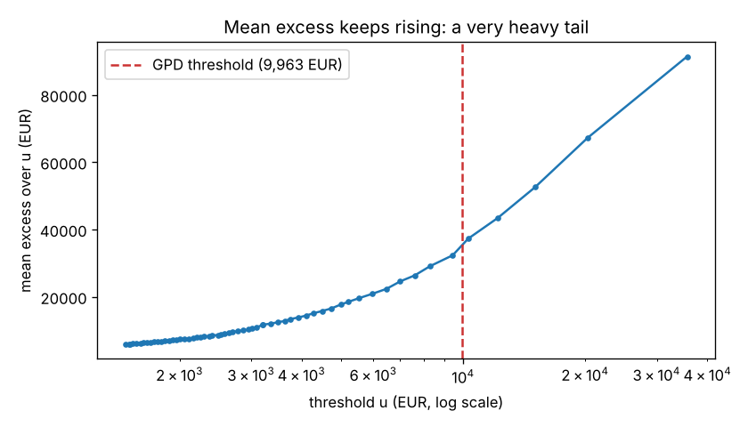

# Motor Claim Severity Model with Extreme-Value Large-Loss Analysis

This project models how much each car insurance claim will cost, using 26,444 real claims from a French insurer. It covers three questions: what the claims are made of, how heavy the tail of very large claims is, and how well claim size can be predicted from the policy below a large-loss cap. It is the severity half of the [motor pricing project](../motor-pricing-fairness/README.md), but here claim amounts are not capped, because the tail is the subject.

## Data

freMTPL2sev from [CASdatasets](https://github.com/dutangc/CASdatasets) has every claim payment from the freMTPL2 portfolio, joined to the policy features: driver age, bonus-malus, vehicle, area, density and region. The 80/20 split by policy is the same as in the pricing project: 21,146 training claims and 5,298 test claims, EUR 59.9M in total.

## What the claims are made of

From `results/metrics.json`:

- **43.5% of claims are paid at one of 7 exact amounts.** 1,204, 1,128.12 and 1,172 EUR are the most common. Each of these amounts appears 100 or more times in training. They look like fixed-fee settlements between insurers (France has an inter-insurer agreement with flat rates for small accidents). Together they are 22% of the cost.
- **1.8% of claims are above EUR 10,000, and they carry 34.5% of all claim cost.** The 5 largest claims alone are 13.3% of the cost. They are EUR 4.08M, 1.40M, 1.30M, 774k and 391k. The three largest involved drivers aged 18 to 20.
- The median claim is EUR 1,172 and the mean is EUR 2,266.

## How heavy the tail is

I fit a Generalized Pareto distribution to the 423 training claims above the 98th percentile (EUR 9,963):

| | Value |
|---|---|
| Shape ξ | **1.07** (bootstrap 95% CI 0.88 to 1.30) |
| Claim size seen once in 1,000 claims | GPD EUR 163k, data EUR 182k |
| Claim size seen once in 10,000 claims | GPD EUR 1.89M, data EUR 730k |



A shape above 1 means the fitted distribution has no finite mean. The mean excess plot shows the same thing: the bigger the threshold, the bigger the average excess above it, with no sign of levelling off. In practice this means the historical average of large claims is not a stable number to price on. The two "1 in 10,000" figures differ by more than 2x, because the data has only about 2 claims that far out.

## Predicting claim size below the cap

Each model predicts min(claim, EUR 10,000) from the policy features. Large losses are priced separately as a load (next section).

| Model (test claims) | Gamma deviance | MAE (EUR) | Gini | Predicted / actual |
|---|---|---|---|---|
| constant (training mean) | 0.9066 | 928.6 | ~0 | 1.024 |
| Gamma GLM | 0.8961 | 920.8 | **0.132** | 1.021 |
| GBM, Gamma loss | 0.8973 | 915.8 | 0.116 | 1.015 |
| composite: P(fixed fee) × fee + GBM for the rest | **0.8954** | **907.1** | 0.130 | **1.007** |

- **Claim size is barely predictable from the policy.** The best model cuts deviance by only 1.2% against a constant, and MAE by 2.3%. This is a known result for this dataset: severity depends on the accident, and the policy says little about that. Frequency carries the rating signal (see the pricing project, Gini 0.36).
- **The composite model is slightly the best and the best calibrated.** It separates fixed-fee claims, using a classifier with test AUC 0.656, from the rest.
- **Large claims can't be predicted at all.** A GBM classifier for "claim above EUR 10,000" scores test AUC 0.534 and average precision 0.017, against a base rate of 0.015.

## Large-loss load

Because large claims can't be predicted per policy, their cost is spread over every claim as a load: the average amount above EUR 10,000 per claim.

| | EUR per claim |
|---|---|
| Training claims | 685.5 (bootstrap 95% CI 488 to 924) |
| Training, without its single largest claim | 619.7 |
| Test claims | 1,170.1 |
| Test claims, without the EUR 4.08M claim | 402.7 |

On the training data, the load is 46% on top of the capped severity. One claim moves the test figure from EUR 403 to EUR 1,170 per claim. That is why pricing teams cap claims, fit the tail separately, and set the load from several years of data or from reinsurance cost, not from one sample. With ξ above 1, a per-claim reinsurance limit also matters more than any model refinement.

## About the "claims fraud" part

The original plan was "claims fraud & severity". I couldn't find a public motor claims dataset with real fraud labels that I could use here, so I didn't build a fraud model. Training one on made-up labels would go against the rule of using only real data in this repo.

## Running it

```bash
pip install scikit-learn scipy pandas pyarrow pyreadr matplotlib requests
python run.py               # under 10 seconds once the data is downloaded
pytest -q test_severity.py
```

References: Dutang & Charpentier, CASdatasets; McNeil, Frey & Embrechts, *Quantitative Risk Management* (GPD tail fitting).
