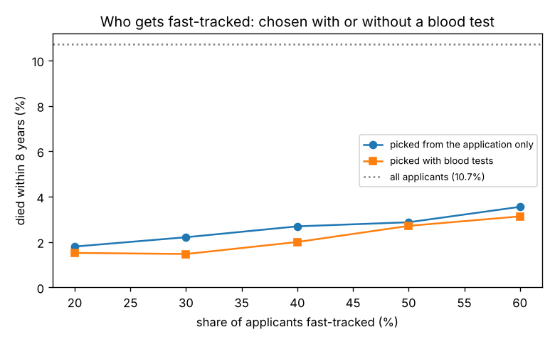

# Life Underwriting Mortality Model on Real Health Exams (NHANES with Death Records)

Life insurers decide who to accept, and at what price, from the application, sometimes a nurse visit, and often a blood test. Blood tests are slow and expensive, so many insurers now "fast-track" some applicants without one. This project measures, on real people with real death records, how much each level of evidence predicts death, and what skipping the blood test costs.

## Data

- **NHANES 2005-06, 2007-08 and 2009-10** (CDC National Health and Nutrition Examination Survey): health questionnaire, physical exam and blood tests.
- **NCHS public-use linked mortality file**: CDC links participants to the National Death Index, with deaths followed to December 31, 2019.

I keep adults examined at ages 40 to 79 who are eligible for linkage: **9,670 people, 1,124 of whom died within 8 years**. Every cycle has at least 9 years of follow-up.

**Split:** I train on 2005 to 2008 and test on the 3,621 people examined in 2009-10. All 45 files are mirrored from the CDC into this repo's `data-v2` release, and checked against a pinned manifest of SHA-256 values.

## Three levels of evidence

| Level | Features |
|---|---|
| application | age, sex, BMI, smoking (current or former), diagnosed high blood pressure, diabetes, heart failure, heart disease, heart attack, stroke, cancer, emphysema |
| paramedical | + measured blood pressure, pulse, waist |
| full labs | + cholesterol, HDL, HbA1c, glucose, albumin, creatinine, BUN, uric acid, liver enzymes (ALT, GGT, alkaline phosphatase), blood count (white cells, hemoglobin, RDW, MCV, platelets) |

Each level is fitted as a logistic regression and as a gradient-boosted model. There are also two baselines:
- **Age only:** what a basic mortality table gives.
- **Rules class + age:** a traditional class decision. Smokers form one class. Others are "preferred" if BMI is 18.5 to 32, blood pressure is under 140/90, and they have no major history; everyone else is "standard".

Race, ethnicity and income are **not** model inputs. They are used only to check the model afterwards.

## Results (3,621 people examined in 2009-10, 10.7% died within 8 years)

From `results/metrics.json`.

| Model | AUC | Brier | Deaths in riskiest 10% | Deaths in safest 50% |
|---|---|---|---|---|
| age only | 0.733 | 0.089 | 28.5% | 4.5% |
| rules class + age | 0.759 | 0.087 | 31.2% | 3.9% |
| application, logistic | 0.796 | 0.082 | 38.1% | 2.9% |
| paramedical, logistic | 0.803 | 0.081 | 40.1% | 2.8% |
| paramedical, GBM | 0.809 | 0.082 | 40.1% | 2.6% |
| **full labs, logistic** | 0.828 | **0.077** | **48.3%** | 2.7% |
| **full labs, GBM** | **0.832** | 0.078 | 43.9% | **2.3%** |

- **The application already does most of the work.** It moves AUC from 0.73 (age alone) to 0.80, and beats the rules class.
  - The rules class does separate risk well: 3.8% of "preferred" people died, against 13.3% of "standard" and 14.6% of smokers.
  - But a model that weighs each answer does better still.
- **The nurse visit adds little.** Its AUC gain over the application is 0.006, with a 95% bootstrap CI of 0.000 to 0.013.
- **The blood test adds real signal.** Its AUC gain is 0.031, with a 95% CI of 0.020 to 0.043. Half of the riskiest 10% by the lab model died within 8 years.
  - The most useful lab values after age are **RDW** (red cell size variation), the **ALT** liver enzyme and **albumin**, by permutation importance in the GBM.
  - RDW and albumin are known general markers of frailty and inflammation. They are not on most people's list of "underwriting labs".

## What skipping the blood test costs



Suppose the insurer fast-tracks the safest share of applicants without a blood test, picked by the application model, instead of testing everyone and picking with labs:

| Share fast-tracked | Died in 8 years, picked from application | Died in 8 years, picked with labs | Same people |
|---|---|---|---|
| 20% | 1.8% | 1.5% | 75% |
| 30% | 2.2% | 1.5% | 83% |
| 50% | 2.9% | 2.7% | 88% |

Fast-tracking 30% of applicants on the application alone accepts a group with a 2.2% death rate. Testing everyone and picking the same share would give 1.5%. Both are far below the 10.7% average. Whether the extra 0.7 points is worth it depends on the policy size, against the cost and delay of the blood test for every applicant. These numbers let a pricing team make that trade-off explicitly.

## Calibration across groups

Actual / expected deaths for the full-labs logistic model. 1.0 means the model is right on average for the group.

**Overall the test cohort is 0.90**, meaning fewer deaths than predicted. People examined in 2009-10 died less than earlier cycles, the trend life insurers call mortality improvement. Compare groups to that 0.90:

| Group | People | A/E |
|---|---|---|
| Non-Hispanic White | 1,710 | 0.97 |
| Non-Hispanic Black | 697 | 0.92 |
| Mexican American | 664 | 0.81 |
| Other Hispanic | 375 | 0.65 |
| income 4x poverty line and above | 910 | 0.66 |
| income 1-2x poverty line | 872 | 1.06 |
| below poverty line | 644 | 0.94 |

The model over-predicts deaths for Hispanic applicants and for the highest-income group, so it would overcharge them. Two known patterns explain this:
- **The "Hispanic paradox":** lower mortality than health measures suggest.
- **Income:** it predicts survival beyond what the exam shows.

The usual remedy is not to add race or income as inputs, which most states would not allow. It is to check calibration by group, as here, before using a model. Groups this size are also noisy: Other Hispanic has 24 deaths.

## Limits

- NHANES participants are a survey sample, not insurance applicants. Applicants are healthier on average, and they can misstate the application, which is why insurers verify it. Here, BMI and diagnoses come from an exam and a confidential survey, so the "application" tier is a best case.
- I don't use the survey weights, so the results describe this sample, not the US population.
- Eight-year deaths are a short window for life insurance, which often runs 20 years or more.

## Running it

```bash
pip install scikit-learn pandas matplotlib requests
python run.py            # under a minute
pytest -q test_underwriting.py
```
