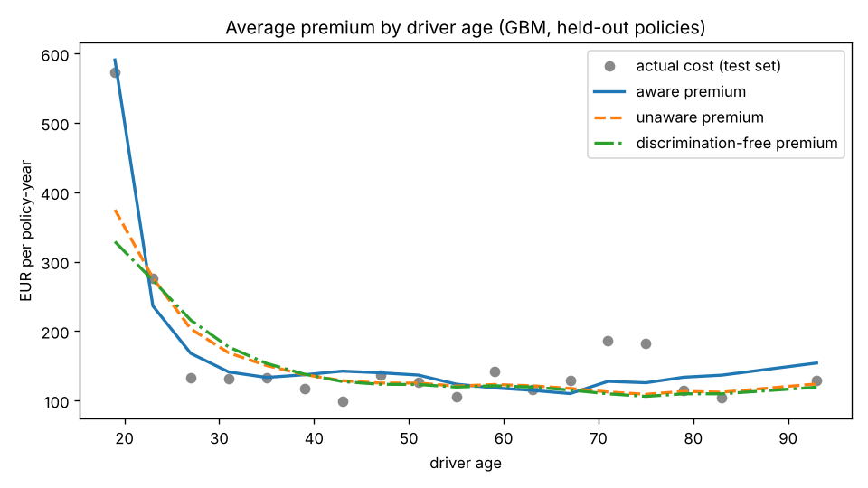

# Motor Insurance Pricing with Discrimination-Free Premiums

A car insurance pricing model built on 678,000 real French motor policies, plus a check of what happens to premiums when a protected attribute is taken out. I fit claim frequency and claim size models (GLM and gradient boosting), then compare three prices: one that uses driver age, one that simply drops it, and a discrimination-free price (Lindholm et al., 2022) that removes age's effect, including the part other features can rebuild.

## Data

freMTPL2 from the [CASdatasets](https://github.com/dutangc/CASdatasets) R package: one French insurer's motor liability portfolio. It has 677,991 policies (358,343 policy-years), 26,405 claims and EUR 52.2M of claim cost. Features: driver age, bonus-malus level, vehicle power, age, brand and fuel, area, population density and region.

`data.py` downloads the two files, checks their SHA-256, and applies the usual cleaning for this dataset (the same as scikit-learn's Tweedie example): claim counts capped at 4, exposure at 1 year, claim amounts at EUR 200,000, and claims with no recorded amount dropped. A fixed 80/20 split by policy gives 135,512 test policies.

## Why driver age

The dataset has no gender, race or income, so there is nothing like the attributes US state rules and the EU gender ruling are about. Driver age is the only personal attribute, and young drivers pay much more, so I use it as the protected attribute to show the method. The same code works for any attribute you can name per policy.

## Models

| | Claim frequency | Claim size |
|---|---|---|
| GLM | Poisson, ages in 10 bins, one-hot categories | Gamma, same features |
| GBM | scikit-learn HistGradientBoosting, Poisson loss | same, Gamma loss |

Both use exposure as a weight. Pure premium = expected frequency × expected claim size.

Three prices from each:

- **aware:** the model uses driver age.
- **unaware:** driver age is dropped. Bonus-malus, car type and region can still stand in for it.
- **discrimination-free:** fit with age, then average each policy's prediction over the portfolio's age mix: price(x) = Σ_d μ(x, d) P(age = d). Two policies that differ only in age get the same price, and other features can't bring age back, because the model already gave age's part to age itself.

Unaware and discrimination-free prices are rescaled so the total premium on the training set equals the aware total.

## Results (135,512 held-out policies)

From `results/metrics.json`.

| | GLM | GBM |
|---|---|---|
| Frequency deviance explained (vs constant rate) | 4.1% | **6.6%** |
| Pure premium Gini (aware) | 0.279 | **0.361** |
| Gini, unaware | 0.257 | 0.343 |
| Gini, discrimination-free | 0.259 | 0.337 |
| Predicted / actual claim cost on test | 1.064 | 1.045 |

The GBM ranks risk clearly better than the GLM. Removing age costs about 0.02 Gini either way. Deviance explained looks small, but that is normal for claim counts: most policies have no claim in a year, so most of the variation is luck. Predicted cost is 4.5% above actual on the test set, mostly from the heavy tail of claim sizes (a few large claims move the total).



How much more drivers aged 18 to 25 pay than drivers aged 26 to 64 (GBM):

| Price | Young driver premium | Gap vs 26-64 | Share of the aware gap kept | Loss ratio, 18-25 | Loss ratio, 65+ |
|---|---|---|---|---|---|
| aware | EUR 334 | +144% | 100% | 1.07 | 1.24 |
| unaware | EUR 304 | +117% | 81% | 1.18 | 1.33 |
| discrimination-free | EUR 289 | +105% | 73% | 1.24 | 1.36 |

The actual cost is EUR 357 per year for 18-25 and EUR 123 for 26-64. Loss ratio = claims paid / premium charged, so above 1 means the group pays less than it costs.

What I take from this:

- **Dropping the column is not enough.** The unaware model keeps 81% of the age gap, because bonus-malus and car features carry age information.
- **Most of the gap is not age itself.** Even the discrimination-free price keeps 73% of it. Young drivers have higher bonus-malus levels and different cars, and those are allowed rating factors. Only the remaining 27% was the direct effect of age.
- **Fairness here is a cross-subsidy, and the table shows its size.** Under the discrimination-free price, young drivers' loss ratio goes from 1.07 to 1.24 and 26-64 year olds pay slightly more (loss ratio 0.90 to 0.87). Whether that trade is right is a business and legal decision. What the model can do is measure it.
- With the GLM the result is different: its discrimination-free price keeps more of the gap (93%) than the unaware one (86%). The age bins and linear bonus-malus term split the effect differently than the trees, so the answer depends on the model, and it should be checked for whichever model is actually used.

The 65+ group costs more than every price charges (loss ratio 1.24 even when age is used). Their test-set cost is pushed up by a few large claims (see the points at ages 70 to 75 in the chart), so I wouldn't read much into that band alone.

## Running it

```bash
pip install scikit-learn pyreadr matplotlib pandas pyarrow
python data.py           # download, check, clean -> data/raw/fremtpl2/policies.parquet
python run.py            # all models and prices, about 10 minutes on a laptop CPU
pytest -q test_pricing.py
```

Reference: M. Lindholm, R. Richman, A. Tsanakas, M. V. Wüthrich (2022), "Discrimination-free insurance pricing", ASTIN Bulletin 52(1).
