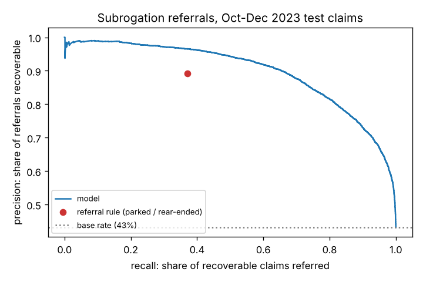

# Subrogation Opportunity Detection from Crash Reports

When another driver causes a crash, the insurer that pays its own customer can recover the money from the at-fault driver's insurer. This is called subrogation. Insurers miss a share of these recoveries because claims handlers don't spot them early. This project builds a referral model that flags recoverable claims at first notice of loss, and compares it with the classic rule: "our car was parked, or stopped and hit from behind".

## Data

**NYC Motor Vehicle Collisions, 2023** (NYPD crash reports, NYC Open Data):
- 96,608 crashes and 194,968 vehicles.
- For each vehicle: its maneuver before the crash, point of impact, damage, type and model year.
- The officer's contributing factors for each driver.

I download it through the city's Socrata API and mirror it into this repo's `data-v2` release with a SHA-256 check.

**Turning crashes into claims.** Each of the 73,645 two-vehicle crashes becomes two claims, one from each car's point of view, so 147,290 claims in all. The label comes from the police factors:
- **Recoverable:** the other driver has a driver-fault factor and ours has none.
- **Not recoverable:** our driver has one. This includes both drivers at fault, which is at best a shared-fault argument.
- Driver-fault factors are things like following too closely, failure to yield, unsafe backing and distraction. Weather, road and vehicle defects don't count.
- 28% of claims have no driver factor recorded ("Unspecified") for either car. They have no label, so I leave them out of training and testing.

**What the model may use:** only what a claims handler hears at first notice:
- both cars' maneuvers;
- our point of impact and damage;
- vehicle types and ages, and occupants;
- time, borough and injuries.

The police factors are never features. A test checks this.

**Split:** train on January to September (79,692 labelled claims), test on October to December (26,098). 43% of labelled claims are recoverable.

## Results (26,098 test claims)

From `results/metrics.json`.



| Referral approach | Claims referred | Precision | Recall |
|---|---|---|---|
| rule: parked, or stopped/slowing and hit from behind | 18% | 89.2% | 37.1% |
| model, same number of referrals | 18% | **96.2%** | 40.1% |
| model, 30% referred | 30% | 90.9% | **63.2%** |
| model, 40% referred | 40% | 83.3% | 77.2% |

The model's AUC is 0.919 and its average precision is 0.898.

- **At the rule's referral volume, the model is more accurate.** 96% of its referrals are recoverable against 89% for the rule.
- **The bigger win is the claims the rule never looks at.** At 30% referred, the model finds 63% of recoverable claims while staying above 90% precision. The rule finds 37%.
- **Where the extra recoveries come from.** The rule only covers parked and stopped cars. But 56,049 labelled claims are "going straight ahead", and 38% of those are recoverable.
  - The model sorts them by the other car's maneuver: a car turning left across us, changing lanes into us, or backing into us.
  - The other car's maneuver is the second most important feature, after ours.

**Recovery rate by our own maneuver** (labelled claims):

| Our car was | Claims | Recoverable |
|---|---|---|
| stopped in traffic | 3,522 | 91% |
| parked | 15,530 | 89% |
| slowing or stopping | 2,118 | 61% |
| going straight ahead | 56,049 | 38% |
| making a left turn | 6,699 | 27% |
| changing lanes | 2,768 | 6% |
| backing | 2,720 | 6% |

**Unlabelled claims.** Of the 41,500 claims with no police fault factor, the model scores 5,347 above 0.9. In practice, those would be the next place to look. I can't score those referrals, because there is no answer to check them against.

## Limits

- The label is the police officer's view at the scene, not the final liability decision or an actual recovery. Real subrogation also depends on the other driver being insured, on the state's fault rules, and on the amount being worth pursuing.
- New York is a no-fault state for injuries, so recoveries there are mostly for vehicle damage, and for injuries only above a threshold.
- A real model would add claim text, photos and amounts. Ranking referrals by expected recovery in dollars matters more than ranking by probability.

## Running it

```bash
pip install scikit-learn pandas matplotlib requests
python run.py            # about a minute
pytest -q test_subro.py
```
