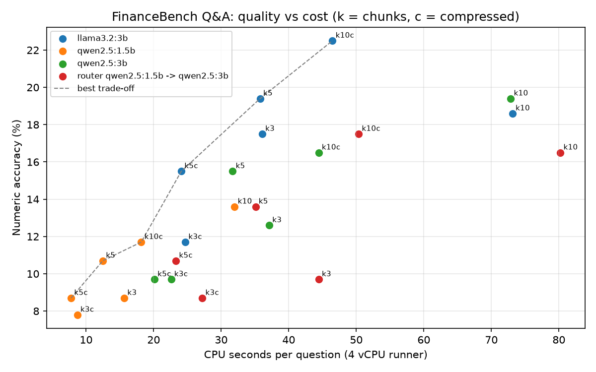

# Production RAG: Cost, Latency and Quality Dashboard

A RAG system in production has knobs that trade money and speed for quality: how many chunks go into the prompt, whether to compress them, which model to use, and whether to route easy questions to a cheaper model. This project measures every combination on real analyst questions and puts the results in a dashboard. Cost is in tokens and CPU seconds, and you can set your own prices.

## Data

**FinanceBench** (Patronus AI, CC BY-NC 4.0): 150 analyst questions over public-company SEC filings (10-Ks, 10-Qs, earnings reports), with gold answers. It uses the same filing pipeline and BM25 retrieval (company/year filters and query expansion) as my [Document Q&A Platform](../../core/document-qa-platform).

## What I compare

Every question is answered under 24 settings:
- **Models:** Qwen2.5 1.5B, Qwen2.5 3B and Llama 3.2 3B, free and local (Ollama on CPU, temperature 0).
- **k:** 3, 5 or 10 retrieved chunks in the prompt.
- **Compression** (`serving.py`): keep only the sentences of each chunk that share the most words with the question, about 40% of the words, in their original order.
- **Router:** ask Qwen 1.5B first, and send the question to Qwen 3B only if the small model refuses, cites nothing, or uses a number that is not in its sources. Both models really answered every question, so the router is scored from real answers, adding up both calls' cost when it escalates.

For every answer I record input and output tokens, wall-clock seconds on a 4 vCPU GitHub runner, whether retrieval found the gold page, refusals, and numbers not found in the sources.

**Quality:** numeric accuracy on the questions with a numeric gold answer, with 1% tolerance and unit scaling. My other projects showed a free 3B judge is unreliable, so I didn't use an LLM grader.

## Results

From `results/summary.json`. Every answer is in `results/answers.jsonl`.

The answers cover 134 of the 150 questions (103 with a numeric answer). Two of the 20 runner jobs died after about 1 hour 45 minutes and left no output, so their 16 questions are missing. Every setting covers the same 134 questions, so the comparison stays fair.



| Setting | Numeric accuracy | Refusals | Answers with a number not in sources | Input tokens | p50 / p95 seconds |
|---|---|---|---|---|---|
| Qwen 1.5B, k=5, compressed (cheapest) | 8.7% | 77% | 3.0% | 1,126 | 6.6 / 15.4 |
| Qwen 1.5B, k=10 | 13.6% | 58% | 6.0% | 3,521 | 29.8 / 56.7 |
| Qwen 3B, k=5 | 15.5% | 66% | 12.7% | 1,836 | 25.8 / 69.1 |
| Qwen 3B, k=10 | 19.4% | 61% | 15.7% | 3,521 | 69.9 / 138.3 |
| Llama 3B, k=5, compressed | 15.5% | 43% | 23.9% | 1,019 | 17.6 / 68.0 |
| Llama 3B, k=5 | 19.4% | 37% | 25.4% | 1,675 | 30.0 / 81.0 |
| **Llama 3B, k=10, compressed (most accurate)** | **22.5%** | 34% | 23.3% | 1,891 | 36.0 / 111.8 |
| Llama 3B, k=10 | 18.6% | 34% | 24.1% | 3,180 | 67.8 / 127.3 |
| Router 1.5B to 3B, k=10 | 16.5% | 51% | 12.7% | 5,959 | 66.8 / 167.1 |

What I learned:
- **Retrieval caps everything.** The gold page is in the top 3 chunks only 21% of the time, the top 5 30%, and the top 10 40%. No model can answer from a page it never sees, so more context is the biggest quality lever. The real fix is better retrieval, not a bigger model.
- **Compression is almost free at k=10.** It cuts input tokens by about 40% and CPU time by 36 to 43%. With Llama at k=10 it *raised* accuracy, from 18.6% to 22.5%: less filler for a small model to get lost in. At k=3 and k=5 it costs 1 to 6 points. **Llama 3B, k=10, compressed is the best setting**: the most accurate, and 36% cheaper than k=10 uncompressed.
- **The router made things worse.** The small model refuses 58 to 81% of the time, so 70 to 87% of questions escalate anyway. The router then pays for two calls and is less accurate than calling Qwen 3B directly. Routing only pays when the cheap model can handle most of the traffic, so I'd measure that first.
- **Models fail differently.** Qwen refuses a lot but rarely makes up numbers (3 to 16% of answers). Llama answers more and gets more right, but a quarter of its answers contain a number not in the sources. In production, Llama's answers would need my number check (from the [agentic RAG copilot](../../core/agentic-rag-copilot)) before anyone sees them.
- **Tail latency matters for capacity planning.** p95 is two to four times p50 everywhere, because long filings make long prompts.

## The dashboard

`dashboard.py` is a Streamlit app that reads the measured results.
- Inputs: your machine's $ per hour, a hosted API's $ per million input/output tokens, and monthly question volume.
- It shows accuracy against cost per 1,000 questions, filters by model, and names the cheapest setting that meets a minimum accuracy.

For example, at an assumed $0.10 per hour for a 4 vCPU machine, the most accurate setting costs about $1.29 per 1,000 questions in compute ($0.0013 per question). A hosted API price can be compared with the token counts in the same table.

```bash
pip install streamlit
streamlit run dashboard.py
```

## Limits

- CPU timings on shared GitHub runners vary from run to run. Compare the settings with each other, not as absolute speeds for your hardware.
- Numeric accuracy only covers questions with a number for an answer. Text answers weren't graded.
- These are free 3B-and-smaller models, so absolute accuracy is low. The point is the method: measure every knob on real questions before choosing.

## Run it

```bash
pytest -q test_serving.py                 # unit tests, no model needed
# full grid: change run-request.txt; GitHub Actions (rag-cost-eval) runs 20 shards and commits results/
```
